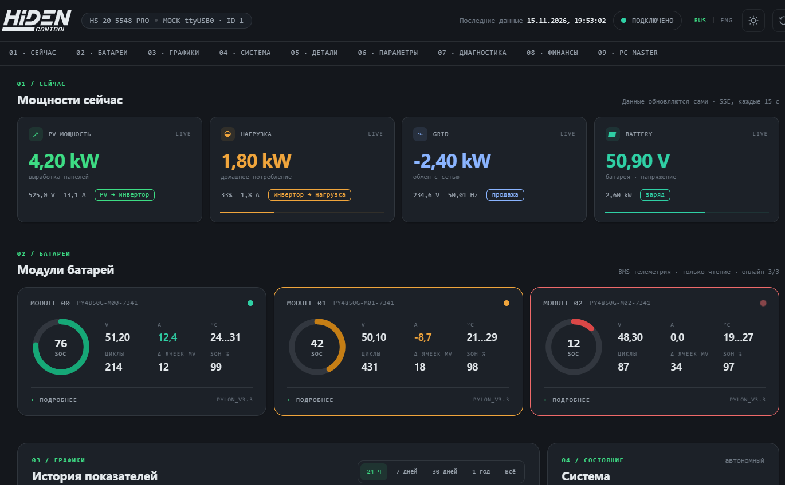
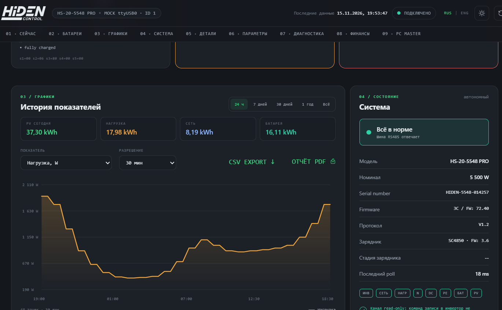
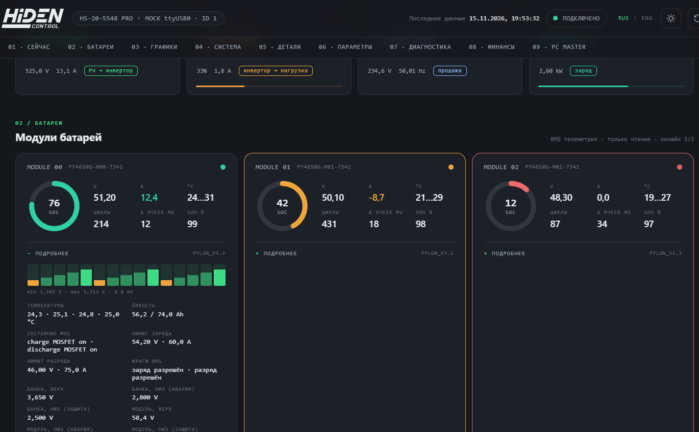
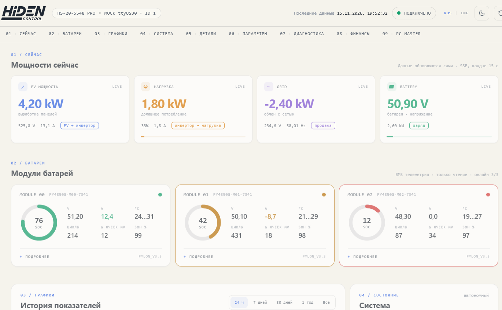
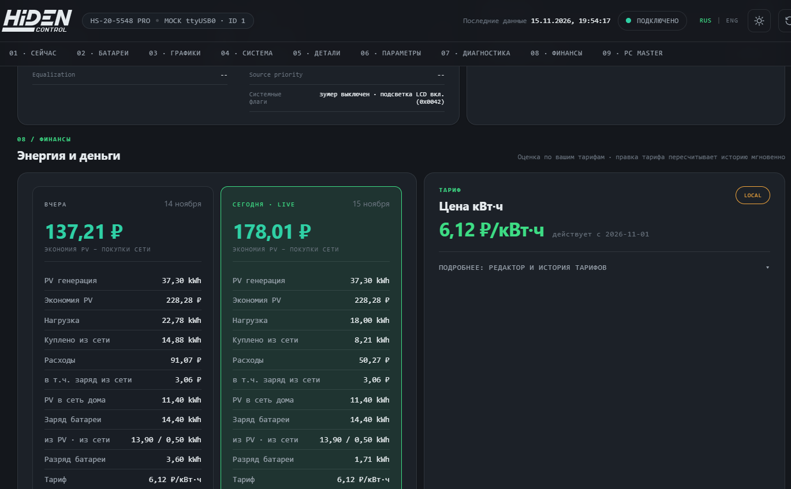
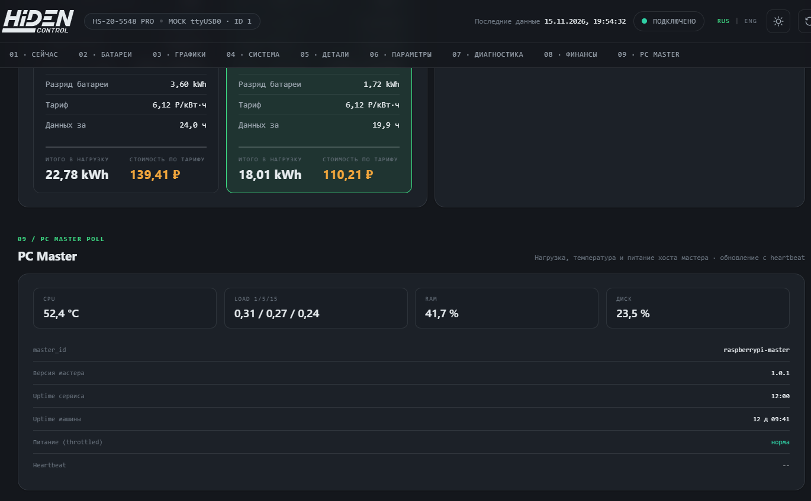
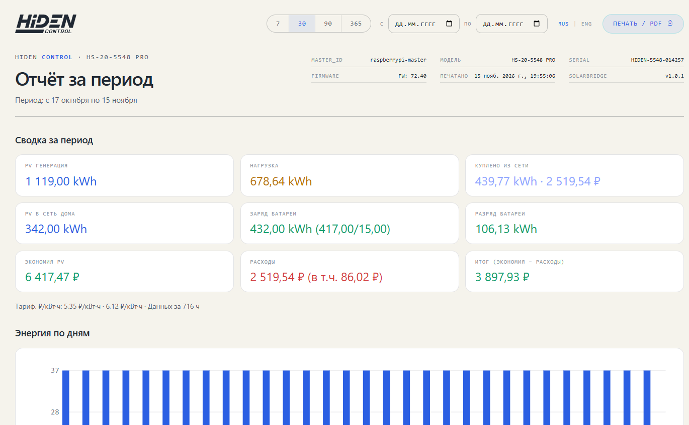

# SolarBridge · HIDEN CONTROL

Local **read-only** monitoring for the **HIDEN HS-20-5548 PRO** solar inverter (Modbus RTU) built around a **master → receiver** architecture: a machine next to the inverter polls the RS485 bus and pushes telemetry frames to remote receivers; every receiver is a full dashboard mirror with its own database, charts and export.

- **Read-only by design.** Not a single write command (0x94/0x95 or any other write CID) exists in the code — there is physically no way to harm the inverter.
- **Fully offline.** No telemetry leaves your network: an HTTP server, SQLite and your RS485 adapter.
- **Both roles from one package.** Master (polling + forwarding) and receiver (ingest + mirror) are configured with the same `install.py` wizard.
- **Interface**: Russian and English, light and dark themes, live SSE updates.

Version **1.0.1**.

## Screenshots

| | |
|---|---|
|  |  |
|  |  |
|  |  |
|  | |

## Architecture

```
HIDEN HS-20-5548 PRO
      │ RS485 (Modbus RTU, read-only)
      ▼
MASTER (Pi / mini-PC near the inverter)            RECEIVER 1..4 (VPS / second box)
  polls the bus every 15 s                            ▲
  stores a frame-sample every 60 s                    │ heartbeats every 15 s
  dashboard http://master:8090                        │ frames: HTTP POST + gzip + Bearer token
  receivers.list ─────────────────────────────────────┘ backfills gaps from the master DB
```

Each machine runs one role (`SB_SOURCE_MODE`):

- **`serial` — master**: owns the RS485 port, polls the inverter (and optionally a separate battery adapter), stores frames in its own database and forwards them to receivers.
- **`ingest` — receiver**: listens on `SB_DASH_HOST:SB_DASH_PORT`, ingests frames from the master, writes them to its own database and serves a full dashboard mirror.

### Data flow

- **A frame = a sample = a DB row.** Every `SB_SAMPLE_INTERVAL` (60 s) the master captures a full inverter (+ battery) snapshot and stores it. Frames are deduplicated by `(master_id, captured_ts)` — re-sending and history imports are safe.
- **Heartbeats every 15 s** (`SB_HEARTBEAT_INTERVAL`) — a small status frame carrying bus state. The receiver distinguishes three master states: **alive** / **alive but RS485 bus error** / **offline** (no heartbeat for longer than `SB_OFFLINE_AFTER_S` = 180 s). Dashboard data older than the same 180 s is shown as stale.
- **The receiver is the source of truth.** On the handshake (`POST /api/ingest/hello`) the receiver reports the timestamp of its last stored sample; the master backfills everything the receiver missed in batches of `SB_FORWARD_BATCH` (240) frames, oldest → newest, pausing `SB_FORWARD_PAUSE_S` (1 s) between batches, up to `SB_FORWARD_PARALLEL` (2) receivers at once.
- **Backfill window** — `SB_FORWARD_BACKFILL_DAYS` (60 days). Frames older than the window are never forwarded: a receiver that fell behind needs a seed.
- **Seeding** — a consistent snapshot of the master database (`VACUUM INTO` + a sha256 passport). The master can hand it out via one-time links: the token lives for `SB_SEED_TOKEN_TTL_HOURS` (24 h), allows at most `SB_SEED_TOKEN_MAX_DOWNLOADS` (10) downloads, and supports resume (HTTP Range). Expired or exhausted seeds are rejected.
- **Schema compatibility.** Frames carry `schema_version` (currently `1`). A master newer than the receiver gets `409 Conflict` — the receiver keeps its data untouched until it is updated.

### Volumes at a 60 s frame (measured: ~7 KB JSON, ~2.1 KB gzip per frame)

| Period | Frames | JSON | gzip |
|---|---|---|---|
| 1 day | 1,440 | ~10 MB | ~3 MB |
| 60 days (backfill window) | 86,400 | ~590 MB | ~177 MB |
| 2 years (default retention) | ~1,051,000 | ~7 GB | ~2.1 GB |

## Dashboard

A single interface with nine sections (ru/en, light and dark themes, live SSE updates every 15 s):

1. **Energy flow** — a live SVG scheme: PV → inverter → grid / load / battery, highlighting the current flow direction.
2. **Battery modules** — a card per module: SOC ring, voltage, current, cycles, cell Δ, SOH. The "Details" block unfolds everything the payload carries: a cell-voltage strip (lowest cell amber, highest cyan, Δ caption in mV), all temperatures, Ah capacities, MOS state, charge/discharge limits (0x92) with BMS flags, protection thresholds (0x47), colour-coded diagnostics and the raw status line.
3. **System behaviour** — charts for any metric with resolutions from 30 min to a year, day totals (PV / load / grid / battery, kWh since local midnight), CSV export (`/api/export.csv`) and the **PDF report** button (`/report`).
4. **System** — status (nominal/alarms), bus errors, operating modes.
5. **Signal details** — AC output, DC/bus, temperatures, accumulated counters (kWh charged/discharged).
6. **Parameters** — charger and inverter settings read from the inverter (read-only); register 20142 "System setting" bits are decoded (display-only, next to the raw code).
7. **Diagnostics** — inverter error/warning bitmaps with decoding, bus response latency, raw register frames.
8. **Finances** — a tariff in ₽/kWh with an effective-from date and a note (configured locally on every machine); "Yesterday" (final) and "Today · LIVE" cards: PV generation, PV savings, load, grid purchases and costs, battery charge (from PV / from grid), discharge and the net result (savings − costs). **Costs are never stored in the database**: money is computed at display time using the tariff of the matching date, and editing a tariff instantly reprices history.
9. **PC Master** ("09 / PC MASTER POLL") — CPU temperature, load 1/5/15, RAM, disk, service and machine uptime, the Raspberry Pi throttled flag (`vcgencmd`), heartbeat age; on receivers the data arrives with the master's heartbeat. Disable with `SB_HOST_STATS=0`. When the master and receiver versions differ, the dashboard shows a warning banner.

## Money and the printable report

- **Tariffs.** One rate in ₽/kWh with an effective-from date (`valid_from`) and a note; tariff history lives in the database and dates before the first tariff fall back to it. The dashboard "TARIFF" panel is compact: only the current rate and its date are visible; the editor and history unfold under "Details". Routes: `GET/POST /api/tariffs`, `DELETE /api/tariffs/{id}`; the computation is `GET /api/finance?days=N&tz=<minutes>&to=YYYY-MM-DD`. There is no export rate: nothing is ever "fed back into the grid" in this setup (PV works into the house grid; the inverter does not push power to the utility).
- **How the money is computed.** The tariff applies to **grid purchases**. The "Yesterday"/"Today" cards show: PV generation and **PV savings** (all generation × tariff — without PV this energy would have come from the grid), the **load** (every kWh that went into the house), **grid purchases + costs**, **incl. grid charging** (which share of the costs charged the battery) and the battery discharge in kWh (no double counting — that is the same PV energy). Net = PV savings − grid purchases. **Costs are never stored in the database**: money is computed at display time using the tariff of the matching date, and editing a tariff instantly reprices history.
- **The `/report`** page is the print view for PDFs: `?days=7|30|90|365` or a custom range `?from=YYYY-MM-DD&to=YYYY-MM-DD`. Period KPI summary, an SVG chart of PV/load/grid by day (beyond 90 days — by month), a day/month table with totals, period records, a battery snapshot and master events. The PDF comes from the browser print dialog (Ctrl+P): print-CSS, A4, the toolbar stays on screen only.

## Dashboard login (optional)

`SB_AUTH=1` closes all dashboard data (`/api/*`, SSE) behind a login; pages and assets stay open (the login form lives there). Logins sit in the **user_list** file next to `.env`, one pair per line — `login:password`, plaintext by the owner's choice (keep it 0640). After a successful login the server issues a token (30 days); the browser remembers it (cookie + localStorage) and never asks again. The file is created by the `install.py` wizard or manually. Master→receiver ingest and seed links keep their own Bearer authentication and are unaffected.

## Disk watchdog and database maintenance

- `SB_DISK_MIN_FREE_PERCENT` (default 10): when the free share of the database filesystem drops below the threshold, the master **stops writing frames to its own DB** and pushes them to receivers directly (the forwarder's live channel; receivers store them normally), and the dashboard shows a red warning. The master dashboard keeps showing live data. `0` disables the guard.
- `install.py` menu → **"Database maintenance: delete data before a date"**: shows the volume, deletes samples and battery rows older than the chosen date and runs `VACUUM` (space returns immediately). Useful when the disk is filling up and old history is no longer needed (the `SB_RETENTION_DAYS` prune removes the same data by age).

## Master recovery from scratch (dead SD card)

Every receiver is a full mirror of the data, so the master can be rebuilt with minimal loss (the last minutes before the receivers stop are the only gap):

1. On the new card: install SolarBridge as usual — `install.py`, the **Master** role (master_id becomes `hostname-XXXXXXXX`; when restoring on the same machine with the same hostname, the receiver history lands without conflicts).
2. On a receiver: the database lives in `/opt/solarbridge/data/solarbridge.sqlite3`. Copy it to the master, e.g.:
   `scp user@receiver:/opt/solarbridge/data/solarbridge.sqlite3 /tmp/rx.sqlite3`
3. On the master: `install.py` → **"Restore master data from a receiver database"** → the file path → transfer mode:
   - **everything** the receiver has;
   - a **date range** (from … to …);
   - **from a date to the end**.
4. The master backs up its (empty) database, imports frames and battery rows with `(master_id, captured_ts)` deduplication — re-running is safe — and restarts the service.
5. Normal master↔receiver traffic resumes afterwards; anything still missing is backfilled through the backfill window.

Re-importing the same file never duplicates data — run it as many times, with as many ranges, as you need.

## Battery monitoring (experimental)

A separate USB-RS485 adapter is wired to the battery bus (the inverter bus is not shared). Supported:

- **MNB LPR-51.2-100** and relatives — PACE BMS ASCII "paceic", verified against live hardware: variants v25 (native PACE), v20 (PACE "PYLON") and the official Pylontech low voltage **V3.3** (for real Pylontech US2000/US3000 packs);
- **PACE Modbus RTU** (V1.3).

Enable with three variables: `SB_BATTERY_MODE=serial` + `SB_BATTERY_SERIAL_PORT` (a separate adapter) + `SB_BATTERY_ADDRESSES` (DIP addresses, e.g. `2,3`). The bus is never auto-scanned — addresses are always explicit. Write commands (0x94/0x95 from the Pylon doc) are not implemented.

## Network and ports

| Machine | Listens on | Purpose |
|---|---|---|
| Master | `SB_DASH_HOST:SB_DASH_PORT` (default `127.0.0.1:8090`) | local dashboard, seed links |
| Receiver | `SB_DASH_HOST:SB_DASH_PORT` (wizard default for receivers — `0.0.0.0:8090`) | ingest from the master + dashboard mirror |

Master → receiver: **HTTP POST only** to `…/api/ingest/hello`, `…/api/ingest/frames`, `…/api/ingest/heartbeat` (gzip + Bearer token). Receivers never open connections back to the master.

For nftables rules see the [nftables section of INSTALL.md](INSTALL.en.md#nftables-open-ports-deliberately). In short:

- direct receiver: open `tcp/8090` only for the master's IP (`ip saddr <master> tcp dport 8090 accept`);
- receiver behind nginx: open only `tcp/443` (+`80` for redirect) and keep the service on `127.0.0.1`.

## Security

- **One Bearer token per receiver** (`SB_INGEST_TOKEN`, 64 hex chars). The master keeps tokens in `receivers.list` (mode 0640); the receiver keeps its token in its own `.env`. Leaking one receiver's token does not expose the others.
- **IP allowlist** (`SB_INGEST_ALLOWLIST`, comma-separated CIDRs) is checked before the token: not on the list → `403 Forbidden`.
- **Rate limit for unauthenticated attempts**: more than 30 failed ingest requests per 60 s from one IP → `429 Too Many Requests` with `Retry-After`.
- **Headers** on every response: `X-Content-Type-Options: nosniff`, `X-Frame-Options: DENY`, `Referrer-Policy: no-referrer`, `Cross-Origin-Opener-Policy: same-origin` (HTTPS/localhost only).
- **X-Forwarded-For** is honoured only when `SB_TRUST_PROXY=1` (receiver behind nginx); otherwise the TCP peer address is used. With nginx set `proxy_set_header X-Forwarded-For $remote_addr;` — otherwise a client can spoof the allowlist check.
- **Ingest is protected, viewing is not.** Token/allowlist/rate-limit apply to `/api/ingest/*`. GET routes (the dashboard, `/api/*`) are public: if a receiver is reachable from the network, restrict viewing with nftables (master + your IPs) or nginx basic auth.
- **Secrets are not copied to receivers**: `receivers.list` belongs to the master only; the master `.env` holds serial-bus parameters.

## Configuration

All variables with comments live in [.env.example](.env.example). Usually the `install.py` wizard writes everything. Key settings:

| Variable | Default | Meaning |
|---|---|---|
| `SB_SOURCE_MODE` | `serial` | Role: `serial` (master) / `ingest` (receiver) |
| `SB_MASTER_ID` | hostname | Master identifier. **Never change retroactively** — frames are deduplicated by `(master_id, captured_ts)`. The wizard generates `hostname-XXXXXXXX` (e.g. `raspberrypi-B349HCFD`) at install time |
| `SB_DASH_HOST` / `SB_DASH_PORT` | `127.0.0.1` / `8090` | Dashboard address/port. Receivers get `0.0.0.0` from the wizard |
| `SB_DB_PATH` | `data/solarbridge.sqlite3` | Database path (relative paths resolve against the project dir) |
| `SB_RETENTION_DAYS` | `730` | History depth (≈ 7.6 GB at a 60 s frame) |
| `SB_SERIAL_PORT` | by-id path | Inverter RS485 adapter (master). A stable by-id/by-path path survives ttyUSB renumbering |
| `SB_SLAVE_ID` / `SB_BAUDRATE` | `4` / `19200` | Inverter Modbus address and speed |
| `SB_POLL_INTERVAL` / `SB_SAMPLE_INTERVAL` / `SB_CONFIG_INTERVAL` | `15` / `60` / `300` | Bus poll / frame store / config read, seconds |
| `SB_FORWARD_BACKFILL_DAYS` | `60` | Receiver backfill window; `0` = live only |
| `SB_FORWARD_BATCH` / `SB_FORWARD_PAUSE_S` / `SB_FORWARD_PARALLEL` | `240` / `1.0` / `2` | Backfill parameters |
| `SB_HEARTBEAT_INTERVAL` / `SB_OFFLINE_AFTER_S` | `15` / `180` | Heartbeat / "offline" and data-stale threshold |
| `SB_INGEST_TOKEN` | — | Receiver token (mandatory in the `ingest` role) |
| `SB_INGEST_ALLOWLIST` | empty | Ingest IP allowlist (CIDRs/addresses, comma-separated) |
| `SB_TRUST_PROXY` | `0` | `1` = trust `X-Forwarded-For` (receiver behind nginx) |
| `SB_SEED_MAX_AGE_DAYS` | `0` (=window) | Seed freshness: older is refused |
| `SB_SEED_TOKEN_TTL_HOURS` / `SB_SEED_TOKEN_MAX_DOWNLOADS` | `24` / `10` | Seed link parameters |
| `SB_BATTERY_MODE` | `off` | `serial` = battery monitoring (experimental) |
| `SB_BATTERY_SERIAL_PORT` / `SB_BATTERY_BAUDRATE` | — / `9600` | Dedicated battery-bus adapter |
| `SB_BATTERY_PROTOCOL` / `SB_BATTERY_VARIANT` | `auto` | `ascii`/`modbus`; ASCII variant: `auto`/`v25`/`v20`/`pylon` |
| `SB_BATTERY_ADDRESSES` | empty | Module DIP addresses (1..15), e.g. `2,3` |
| `SB_BATTERY_POLL_INTERVAL` | `20` | Battery bus poll interval, seconds |
| `SB_HOST_STATS` | `1` | Master host metrics ("09 / PC MASTER POLL") in `/api/current` and heartbeats; `0` = hide the section |
| `SB_AUTH` | `0` | `1` = dashboard login required (the `SB_USER_LIST` file; 30-day token in the browser) |
| `SB_USER_LIST` | `user_list` | File of "login:password" pairs (plaintext; keep it 0640) |
| `SB_DISK_MIN_FREE_PERCENT` | `10` | Disk watchdog: below the threshold the master writes to receivers only + dashboard banner; `0` = off |
| `SB_UPDATE_URL` | `https://github.com/lepik/solarbridge` | Release source for `update.py` (GitHub repository or a direct zip URL) |
| `SB_RECEIVERS_FILE` | `receivers.list` | Master's receiver list |

## receivers.list (master only)

```
name | URL | token | on/off
```

```text
vps1 | https://vps1.example.com | 9f86d081884c7d659a2feaa0c55ad015… | on
vps2 | http://198.51.100.7:8090  | 2c26b46b68ffc68ff99b453c1d304134… | on
```

- Every receiver has **its own token**; the same token sits in the receiver's `.env`.
- `off` disables a receiver temporarily without deleting the line.
- The file is re-read automatically (hot-reload), no service restart; a broken line is skipped and logged.
- A fully commented example — [receivers.list.example](receivers.list.example).

## Updates and compatibility

- **`update.py`** — updates from a public release (release = zip + `.sha256`). The script is a single dependency-free file included in the package; after installation it lives in `/opt/solarbridge/update.py`:
  - `sudo python3 update.py --check` — compare versions only (installed vs available);
  - `sudo python3 update.py` — fetch the latest release, verify the sha256, back up, apply and restart the service. The source is `SB_UPDATE_URL` in `.env` (a GitHub repository or a direct zip URL) or `--url`;
  - `sudo python3 update.py --from solarbridge-1.1.0.zip` — offline update from a local file (a sibling `.sha256` is verified when present);
  - downgrades are refused without `--force`; `.env`, `data/`, `receivers.list` and `.venv` are never overwritten;
  - after applying, `update.py` waits for `/healthz` for 60 s; if the service does not come up it **rolls back automatically** from the backup and restarts. Backups live in `backups/` (the last 2 are kept).
- Replacing code files with the cumulative zip needs no migration: a database schema mismatch is caught during the master/receiver handshake, neither side loses data.
- `SB_MASTER_ID` must not be changed retroactively: the receiver would treat the "new" master as a different source.
- Master and receiver versions must match: on a mismatch the dashboard shows a banner (the master version arrives with heartbeats) and a version change is recorded as an event.

## Package contents

```
install.py                 installer and management menu
update.py                  update from a public release (zip + sha256, rollback)
main.py                    service entry point
solarbridge/               config, storage, decode, modbus, poller, http,
                           forwarder, receiver, seed, battery, hoststats
public/                    dashboard (ru/en, themes, SSE, CSV) + the /report print view
tests/                     unit tests (python -m unittest discover -s tests)
.env.example               every variable with comments
receivers.list.example     receiver list format
deploy/solarbridge.service tuned systemd unit (sandboxing, DeviceAllow)
doc/                       factory protocol documentation (PDF/XLSX)
screenshots/               dashboard screenshots
README.md / README.en.md   this file (ru/en)
INSTALL.md / INSTALL.en.md step-by-step installation (ru/en)
CHANGELOG.md               version history
requirements.txt           pyserial>=3.5 — the only external dependency
```

## Release Notes 1.0.1

- **Tariffs and finances** ("Finances"): a ₽/kWh rate with an effective-from date, "Yesterday" and "Today · LIVE" cards, instant history repricing when a tariff changes. Costs are never stored in the database.
- **"Master machine"**: master host metrics (CPU/load/RAM/disk/uptime/throttled) on the dashboard and in receiver heartbeats (`SB_HOST_STATS`).
- **Version-mismatch banner** between master and receiver + the `master_version` event.
- **Printable report `/report`**: any period, KPI summary, chart, totals table, records, batteries, events; PDF via Ctrl+P; the report button sits next to CSV export.
- **Dashboard login** (`SB_AUTH=1`, the user_list file): 30-day browser token; ingest and seed keep their own Bearer tokens.
- **Disk watchdog** (`SB_DISK_MIN_FREE_PERCENT`): when space runs low, local writes pause, frames stream to receivers directly and the dashboard shows a warning. install.py gains "Database maintenance: delete data before a date" (VACUUM).
- **Master recovery from a receiver database** (dead SD card): deduplicated import with "everything / date range / from a date" modes — an install.py menu item.
- **master_id with a random suffix**: the wizard generates `hostname-XXXXXXXX` — protection against an impostor master.
- The "TARIFF" panel is compact now: the current rate and date are visible; the editor and history unfold under "Details".
- Section "09" renamed to **"09 / PC MASTER POLL" / "PC Master"**.
- **`update.py`**: updates from a public release with sha256 verification, a backup and an automatic rollback when healthz fails.
- Регистр 20142 "System setting" — bits 0–6 decoded (display-only).
- 149 unit tests.

---

**Read-only.** SolarBridge contains no write commands for the inverter or the BMS — they do not exist and will not be added.

HIDEN and MUST are trademarks of their respective owners. SolarBridge is an independent project, not affiliated with the manufacturers; compatibility is verified on the hardware listed in this README.
