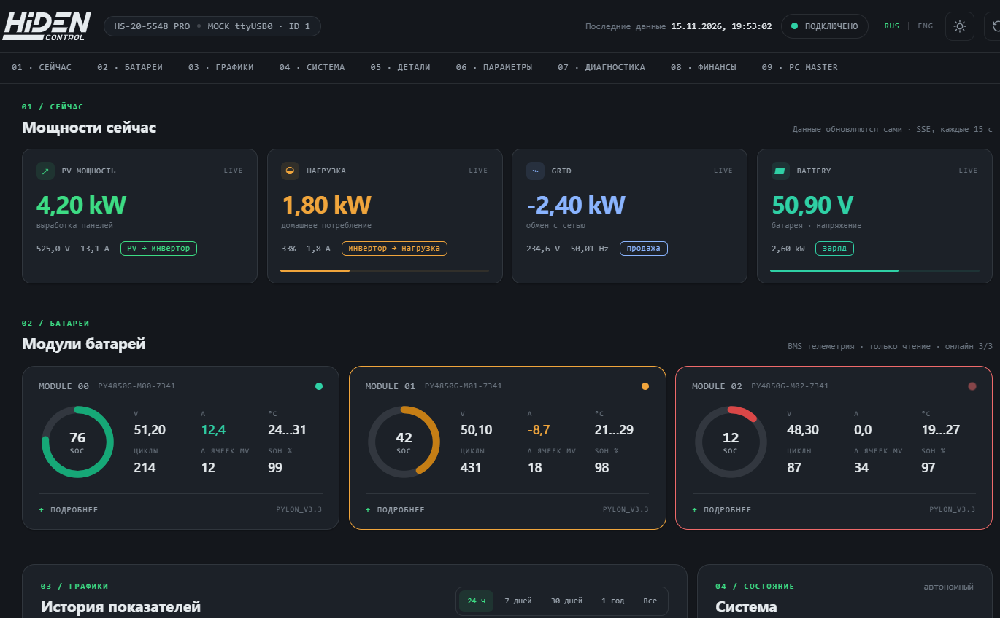
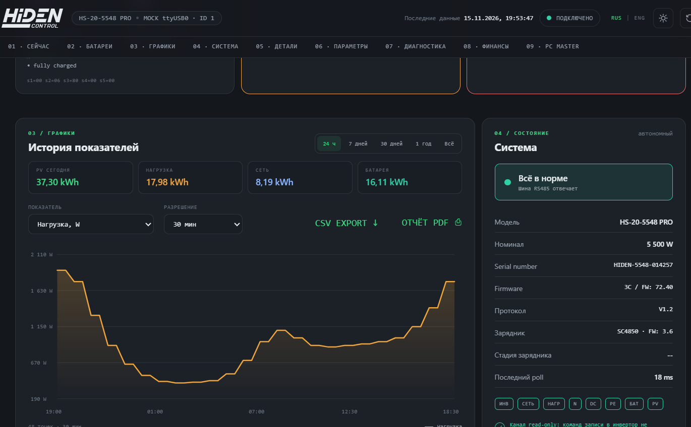
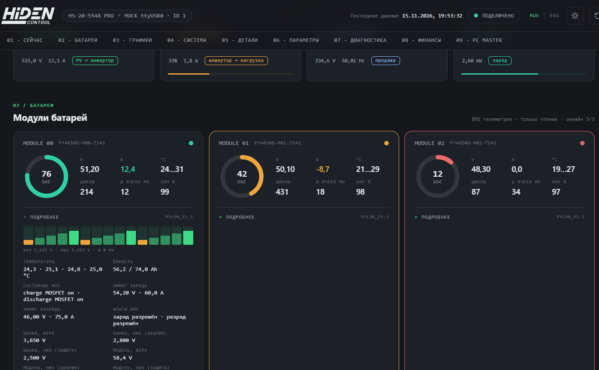
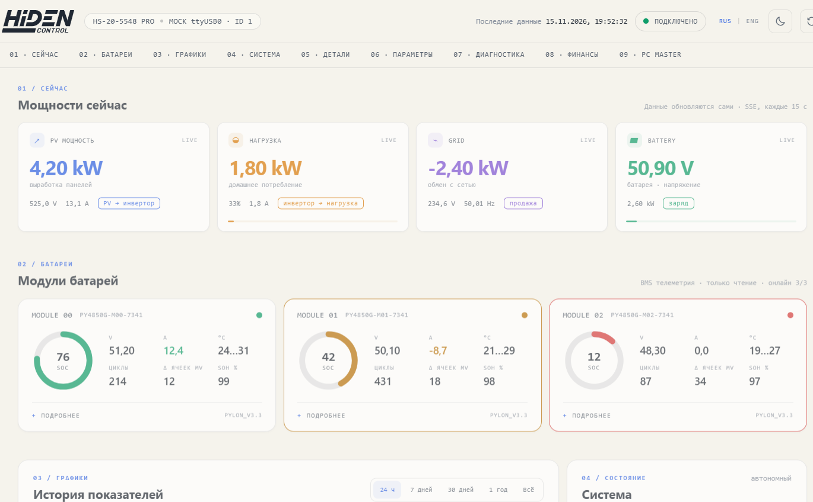
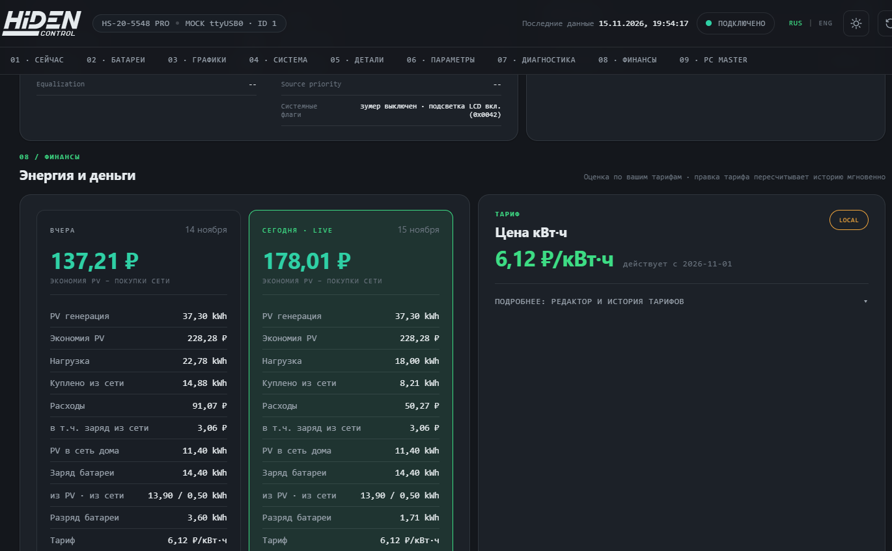
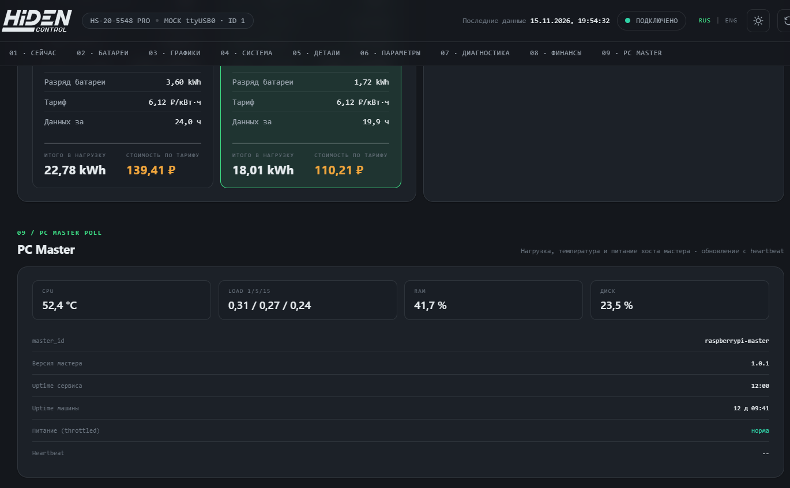
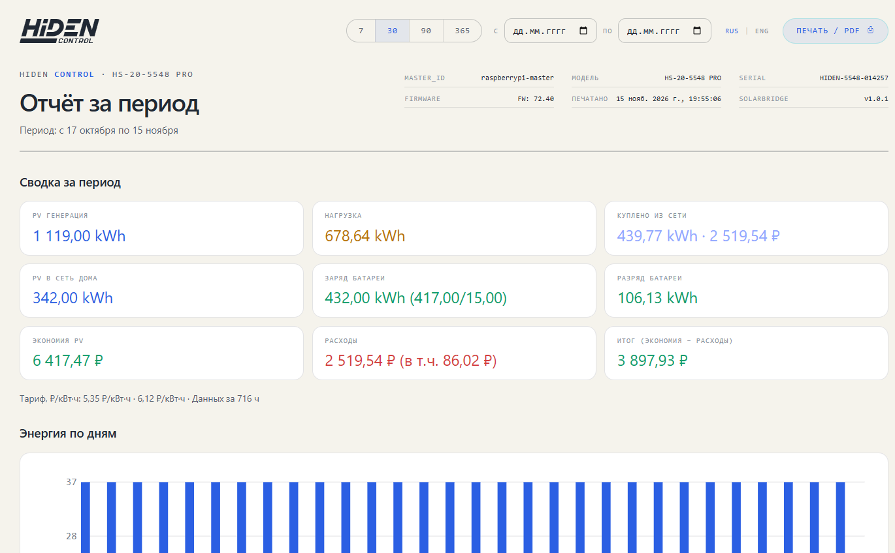

# SolarBridge · HIDEN CONTROL

Локальный **read-only** мониторинг солнечного инвертора **HIDEN HS-20-5548 PRO** (Modbus RTU) с архитектурой **«мастер → приёмник»**: машина у инвертора опрашивает шину RS485 и рассылает кадры телеметрии удалённым приёмникам, каждый приёмник — полноценное зеркало дашборда со своей базой, графиками и экспортом.

- **Только чтение.** В протоколе не реализовано ни одной команды записи (0x94/0x95 и прочие write-CID не существуют в коде) — инвертору физически нечем навредить.
- **Полностью офлайн.** Ни телеметрии наружу, ни внешних сервисов: HTTP-сервер, SQLite и ваш RS485-адаптер.
- **Обе роли из одного пакета.** Мастер (опрос + рассылка) и приёмник (приём + зеркало) настраиваются одним установщиком `install.py`.
- **Интерфейс**: русский и английский, светлая и тёмная темы, живые обновления по SSE.

Версия **1.0.1**.

## Скриншоты

| | |
|---|---|
|  |  |
|  |  |
|  |  |
|  | |

## Архитектура

```
HIDEN HS-20-5548 PRO
      │ RS485 (Modbus RTU, только чтение)
      ▼
МАСТЕР (малина/мини-ПК у инвертора)                ПРИЁМНИК 1..4 (VPS/вторая машина)
  опрос шины каждые 15 с                              ▲
  кадр-сэмпл в БД каждые 60 с                         │ heartbeat 15 с
  дашборд http://мастер:8090                          │ кадры: HTTP POST + gzip + Bearer-токен
  receivers.list ─────────────────────────────────────┘ догрузка пропусков из БД мастера
```

Каждая машина работает в одной из ролей (`SB_SOURCE_MODE`):

- **`serial` — мастер**: держит RS485-порт, опрашивает инвертор (и опционально отдельный адаптер батарей), пишет кадры в свою базу и рассылает их приёмникам.
- **`ingest` — приёмник**: слушает `SB_DASH_HOST:SB_DASH_PORT`, принимает кадры от мастера, пишет в свою базу, отдаёт полноценный дашборд.

### Поток данных

- **Кадр = сэмпл = запись в БД.** Каждые `SB_SAMPLE_INTERVAL` (60 с) мастер фиксирует полный срез инвертора (+ батарей) и сохраняет его. Дедупликация по паре `(master_id, captured_ts)` — повторная отправка и импорт истории безопасны.
- **Heartbeat каждые 15 с** (`SB_HEARTBEAT_INTERVAL`) — маленький статусный кадр с состоянием шины. Приёмник различает три состояния мастера: **жив** / **жив, но ошибка шины RS485** / **offline** (heartbeat нет дольше `SB_OFFLINE_AFTER_S` = 180 с). Данные на дашборде считаются устаревшими через те же 180 с.
- **Истина — по приёмнику.** При рукопожатии (`POST /api/ingest/hello`) приёмник сообщает метку последнего хранимого сэмпла; мастер догружает всё, чего у приёмника нет, батчами по `SB_FORWARD_BATCH` (240) кадров, старые → новые, пауза `SB_FORWARD_PAUSE_S` (1 с), до `SB_FORWARD_PARALLEL` (2) приёмников одновременно.
- **Окно догрузки** — `SB_FORWARD_BACKFILL_DAYS` (60 дней). Кадры старше окна не пересылаются: приёмник, отставший глубже окна, набирает историю через пересев (seed).
- **Пересев (seed)** — согласованный снимок базы мастера (`VACUUM INTO` + паспорт с sha256). Мастер умеет раздавать его по одноразовым ссылкам (`POST /api/seed/…`): токен живёт `SB_SEED_TOKEN_TTL_HOURS` (24 ч), допускает до `SB_SEED_TOKEN_MAX_DOWNLOADS` (10) скачиваний, поддерживает докачку (HTTP Range). Просроченный или исчерпанный seed отклоняется.
- **Совместимость схем.** В кадрах передаётся `schema_version` (сейчас `1`). Мастер «новее» приёмника — приёмник отвечает `409 Conflict` и продолжает хранить свои данные без потерь; обновление приёмника делает новую версию совместимой.

### Объёмы при 60-секундном кадре (замер: ~7 КБ JSON, ~2,1 КБ gzip на кадр)

| Период | Кадров | JSON | gzip |
|---|---|---|---|
| Сутки | 1 440 | ~10 МБ | ~3 МБ |
| 60 дней (окно догрузки) | 86 400 | ~590 МБ | ~177 МБ |
| 2 года (retention по умолчанию) | ~1 051 000 | ~7 ГБ | ~2,1 ГБ |

## Дашборд

Единый интерфейс из девяти секций (ru/en, тёмная и светлая темы, live-обновления по SSE каждые 15 с):

1. **Поток энергии** — живая SVG-схема: PV → инвертор → сеть / нагрузка / батареи, с активной подсветкой текущего направления потока.
2. **Модули батарей** — карточки каждого модуля: кольцо SOC, напряжение, ток, циклы, Δ ячеек, SOH. Блок «Подробнее» раскрывает максимум из payload: полосу напряжений ячеек (минимальная — янтарная, максимальная — голубая, подпись Δ в мВ), все температуры, ёмкости Ah, состояние MOS, лимиты заряда/разряда (0x92) с флагами BMS, пороги защит (0x47), диагностику (protection/alarms цветом) и сырую строку статуса.
3. **Поведение системы** — графики по любому показателю с разрешением от 30 мин до года, итоги дня (PV / нагрузка / сеть / батареи, kWh с начала суток), CSV-экспорт (`/api/export.csv`) и кнопка **«Отчёт PDF»** (`/report`).
4. **Система** — статус (номинал/аварии), bus-ошибки, режимы работы.
5. **Детали сигнала** — AC-выход, DC/шина, температуры, накопленные счётчики (кВт·ч заряда/разряда).
6. **Параметры** — зарядный и инверторный контуры, прочитанные из инвертора (read-only); биты регистра 20142 «System setting» расшифрованы (display-only, рядом с сырым кодом).
7. **Диагностика** — битовые карты ошибок/предупреждений инвертора с расшифровкой, задержка ответа шины, raw-кадры регистров.
8. **Финансы** — тариф ₽/кВт·ч с датой начала действия и заметкой (настраивается локально на каждой машине), карточки «Вчера» (итог) и «Сегодня · LIVE»: PV-генерация, экономия PV, нагрузка, покупки из сети и расходы, заряд батареи (из PV / из сети), разряд и итог «экономия − расходы». **Стоимости в БД не хранятся**: деньги считаются на момент показа по тарифу соответствующей даты, правка тарифа мгновенно пересчитывает историю.
9. **PC Master** («09 / PC MASTER POLL») — температура CPU, load 1/5/15, RAM, диск, uptime сервиса и машины, throttled-флаг Raspberry Pi (`vcgencmd`), возраст heartbeat; на приёмнике данные приходят с heartbeat мастера. Отключается `SB_HOST_STATS=0`. При расхождении версий мастера и приёмника дашборд показывает баннер-предупреждение.

## Деньги и печатный отчёт

- **Тарифы.** Одна ставка ₽/кВт·ч с датой начала действия (`valid_from`) и заметкой; история тарифов хранится в БД, до первого тарифа применяется самый ранний. Панель «ТАРИФ» на дашборде компактна: видна только текущая ставка и дата; редактор и история раскрываются по «Подробнее». Роуты: `GET/POST /api/tariffs`, `DELETE /api/tariffs/{id}`; расчёт — `GET /api/finance?days=N&tz=<минуты>&to=ГГГГ-ММ-ДД`. Экспортной ставки нет: «подмешивания в сеть» в этой схеме не бывает (PV работает в домашнюю сеть, инвертор не отдаёт в городскую).
- **Как считаются деньги.** Тариф применяется к **покупкам из сети**. Карточка «Вчера»/«Сегодня» показывает: PV-генерацию и **экономию PV** (вся генерация × тариф — без PV эта энергия пришла бы из сети), **нагрузку** (весь kWh, ушедший в дом), **куплено из сети + расходы**, **в т.ч. заряд из сети** (какая часть расходов пошла на заряд батареи), разряд батареи в kWh (без двойного учёта денег — это та же PV-энергия). Итог = экономия PV − покупки из сети. **Стоимости в БД не хранятся**: деньги считаются на момент показа по тарифу соответствующей даты, правка тарифа мгновенно пересчитывает историю.
- **Отчёт `/report`** — печатная версия для PDF: `?days=7|30|90|365` или произвольный диапазон `?from=ГГГГ-ММ-ДД&to=ГГГГ-ММ-ДД`. Сводка KPI периода, SVG-график PV/нагрузка/сеть по дням (свыше 90 дней — по месяцам), таблица суток/месяцев с итогами, рекорды периода, снимок батарей, события мастера. PDF — печать браузера (Ctrl+P): print-CSS A4, тулбар на печать не попадает.

## Вход по логину/паролю (опционально)

`SB_AUTH=1` — все данные дашборда (`/api/*`, SSE) закрываются входом; страницы и статика остаются открытыми (в них живёт форма входа). Логины хранятся в файле **user_list** рядом с `.env`, по паре на строку — `login:password`, открытый текст по решению владельца (держите права 0640). После успешного входа сервер выдаёт токен (30 дней), браузер сохраняет его (cookie + localStorage) и больше не спрашивает пароль. Create/update файла — вопрос визарда `install.py` или вручную. Ингест мастеров и seed-ссылки защищены независимо (свой Bearer-токен) и от этой опции не зависят.

## Дисковый сторож и обслуживание базы

- `SB_DISK_MIN_FREE_PERCENT` (по умолчанию 10): когда на разделе с БД свободно меньше порога, мастер **прекращает писать кадры в свою БД** и передаёт их приёмникам напрямую (live-канал форвардера, приёмники хранят их как обычно), а на дашборде выводится красное предупреждение. Дашборд мастера при этом продолжает показывать живые данные. `0` — сторож выключен.
- Меню `install.py` → **«Обслуживание базы: удалить данные до даты»**: показывает объём, удаляет сэмплы и батарейные строки старше выбранной даты и делает `VACUUM` (место возвращается сразу). Полезно, когда место кончается, а старая история не нужна (ретеншн по `SB_RETENTION_DAYS` чистит то же самое, но по возрасту).

## Восстановление мастера с нуля (умерла SD-карта)

Каждый приёмник — полное зеркало базы, поэтому мастер восстанавливается с минимальной потерей (хвост последних минут до остановки приёмников):

1. На новой карте: поставьте SolarBridge как обычно — `install.py`, роль **Мастер** (master_id будет `hostname-XXXXXXXX`; если восстанавливаете на той же машине с тем же именем — история с приёмников сядет без конфликтов).
2. На приёмнике: база лежит в `/opt/solarbridge/data/solarbridge.sqlite3`. Скопируйте её на мастера, например:
   `scp user@receiver:/opt/solarbridge/data/solarbridge.sqlite3 /tmp/rx.sqlite3`
3. На мастере: `install.py` → **«Восстановить данные из базы приёмника»** → путь к файлу → режим переноса:
   - **всё**, что есть у приёмника;
   - **диапазон дат** (с … по …);
   - **с даты до конца**.
4. Мастер делает бэкап своей (пустой) базы, переносит кадры и батарейные строки с дедупликацией по `(master_id, captured_ts)` — повторный запуск безопасен, — и возвращает службу.
5. Дальше мастера и приёмники продолжают обычный обмен: недостающее дозагрузится по окну догрузки.

Повторный перенос того же файла не дублирует данные — можно запускать несколько раз с разными диапазонами.

## Мониторинг батарей (экспериментально)

Отдельный USB-RS485-адаптер подключается к шине батарей (шина инвертора не используется). Поддержаны:

- **MNB LPR-51.2-100** и родственные — PACE BMS ASCII «paceic», сверен с живым железом: варианты v25 (родной PACE), v20 (PACE «PYLON») и официальный Pylontech low voltage **V3.3** (для настоящих Pylontech US2000/US3000);
- **PACE Modbus RTU** (V1.3).

Включение: `SB_BATTERY_MODE=serial` + `SB_BATTERY_SERIAL_PORT` (отдельный адаптер) + `SB_BATTERY_ADDRESSES` (DIP-адреса, например `2,3`). Автоскана шины нет — адреса всегда явные. Команды записи (0x94/0x95 из доки Pylon) не реализуются.

## Сеть и порты

| Машина | Слушает | Назначение |
|---|---|---|
| Мастер | `SB_DASH_HOST:SB_DASH_PORT` (по умолч. `127.0.0.1:8090`) | локальный дашборд, seed-ссылки |
| Приёмник | `SB_DASH_HOST:SB_DASH_PORT` (дефолт визарда для приёмника — `0.0.0.0:8090`) | ingest от мастера + дашборд-зеркало |

Мастер → приёмник: **только HTTP POST** на `…/api/ingest/hello`, `…/api/ingest/frames`, `…/api/ingest/heartbeat` (gzip + Bearer-токен). Никаких входящих соединений к мастеру от приёмников нет.

Открытие портов в nftables — см. раздел [«nftables» в INSTALL.md](INSTALL.md#nftables-открываем-порты-осознанно). Коротко:

- приёмник напрямую: открыть `tcp/8090` только с IP мастера (`ip saddr <master> tcp dport 8090 accept`);
- приёмник за nginx: открыть только `tcp/443` (+`80` на redirect), сам сервис держать на `127.0.0.1`.

## Безопасность

- **Bearer-токен на каждый приёмник** (`SB_INGEST_TOKEN`, 64 hex-символа). Мастер хранит токены в `receivers.list` (права 0640), приёмник — в своём `.env`. Утечка токена одного приёмника не открывает другим.
- **IP-allowlist** (`SB_INGEST_ALLOWLIST`, CIDR через запятую) — проверяется до токена: не из списка → `403 Forbidden`.
- **Rate-limit неавторизованных**: >30 неудачных попыток ingest за 60 с с одного IP → `429 Too Many Requests` с `Retry-After`.
- **Заголовки** на всех ответах: `X-Content-Type-Options: nosniff`, `X-Frame-Options: DENY`, `Referrer-Policy: no-referrer`, `Cross-Origin-Opener-Policy: same-origin` (только для HTTPS/localhost).
- **X-Forwarded-For** принимается во внимание только при `SB_TRUST_PROXY=1` (приёмник за nginx); иначе считается по TCP-адресу подключения. При nginx ставьте `proxy_set_header X-Forwarded-For $remote_addr;` — иначе клиент может подделать allowlist-проверку.
- **Ингест защищён, просмотр — нет.** Токен/allowlist/rate-limit действуют на `/api/ingest/*`. GET-роуты (дашборд, `/api/*`) публичны: если приёмник доступен из сети, ограничьте просмотр nftables (IP мастера + ваши IP) или basic auth nginx.
- **Секреты не копируются на приёмники**: `receivers.list` нужен только мастеру; `.env` мастера содержит параметры serial-шины.

## Конфигурация

Все переменные с комментариями — в [.env.example](.env.example). Обычно всё ставит визард `install.py`. Ключевое:

| Переменная | Дефолт | Смысл |
|---|---|---|
| `SB_SOURCE_MODE` | `serial` | Роль: `serial` (мастер) / `ingest` (приёмник) |
| `SB_MASTER_ID` | hostname | Идентификатор мастера. **Не менять задним числом** — дедупликация кадров по `(master_id, captured_ts)`. При установке визард генерирует `hostname-XXXXXXXX` (например `raspberrypi-B349HCFD`) |
| `SB_DASH_HOST` / `SB_DASH_PORT` | `127.0.0.1` / `8090` | Адрес и порт веб-интерфейса. Приёмнику визард ставит `0.0.0.0` |
| `SB_DB_PATH` | `data/solarbridge.sqlite3` | Путь к базе (относительные — от каталога проекта) |
| `SB_RETENTION_DAYS` | `730` | Глубина истории (≈ 7,6 ГБ при 60-сек кадре) |
| `SB_SERIAL_PORT` | by-id путь | RS485-адаптер инвертора (мастер). Стабильный by-id/by-path путь переживает смену ttyUSB-номеров |
| `SB_SLAVE_ID` / `SB_BAUDRATE` | `4` / `19200` | Modbus-адрес и скорость инвертора |
| `SB_POLL_INTERVAL` / `SB_SAMPLE_INTERVAL` / `SB_CONFIG_INTERVAL` | `15` / `60` / `300` | Опрос шины / запись кадра / чтение конфигов, с |
| `SB_FORWARD_BACKFILL_DAYS` | `60` | Окно догрузки на приёмники; `0` = только live |
| `SB_FORWARD_BATCH` / `SB_FORWARD_PAUSE_S` / `SB_FORWARD_PARALLEL` | `240` / `1.0` / `2` | Параметры догрузки |
| `SB_HEARTBEAT_INTERVAL` / `SB_OFFLINE_AFTER_S` | `15` / `180` | Heartbeat / порог «offline» и устаревания данных |
| `SB_INGEST_TOKEN` | — | Токен приёмника (обязателен в роли `ingest`) |
| `SB_INGEST_ALLOWLIST` | пусто | IP-allowlist ingest (CIDR/адреса через запятую) |
| `SB_TRUST_PROXY` | `0` | `1` = доверять `X-Forwarded-For` (приёмник за nginx) |
| `SB_SEED_MAX_AGE_DAYS` | `0` (=окно) | Свежесть пересева: старее — отказ |
| `SB_SEED_TOKEN_TTL_HOURS` / `SB_SEED_TOKEN_MAX_DOWNLOADS` | `24` / `10` | Параметры seed-ссылок |
| `SB_BATTERY_MODE` | `off` | `serial` = мониторинг батарей (экспериментально) |
| `SB_BATTERY_SERIAL_PORT` / `SB_BATTERY_BAUDRATE` | — / `9600` | Отдельный адаптер шины батарей |
| `SB_BATTERY_PROTOCOL` / `SB_BATTERY_VARIANT` | `auto` | `ascii`/`modbus`; ASCII-вариант: `auto`/`v25`/`v20`/`pylon` |
| `SB_BATTERY_ADDRESSES` | пусто | DIP-адреса модулей (1..15), например `2,3` |
| `SB_BATTERY_POLL_INTERVAL` | `20` | Опрос шины батарей, с |
| `SB_HOST_STATS` | `1` | Метрики хоста мастера («09 / PC MASTER POLL») в `/api/current` и heartbeat; `0` = выключить секцию |
| `SB_AUTH` | `0` | `1` = вход по логину/паролю на дашборде (файл `SB_USER_LIST`, токен на 30 дней в браузере) |
| `SB_USER_LIST` | `user_list` | Файл пар "login:password" (открытый текст; права 0640) |
| `SB_DISK_MIN_FREE_PERCENT` | `10` | Сторож места: ниже порога мастер пишет только приёмникам + баннер в даш; `0` = выкл |
| `SB_UPDATE_URL` | `https://github.com/lepik/solarbridge` | Источник релизов для `update.py` (репозиторий GitHub или прямой URL zip) |
| `SB_RECEIVERS_FILE` | `receivers.list` | Список приёмников мастера |

## receivers.list (только на мастере)

```
имя | URL | токен | on/off
```

```text
vps1 | https://vps1.example.com | 9f86d081884c7d659a2feaa0c55ad015… | on
vps2 | http://198.51.100.7:8090  | 2c26b46b68ffc68ff99b453c1d304134… | on
```

- Токен **свой у каждого приёмника**; тот же токен лежит в `.env` приёмника.
- `off` временно отключает приёмника без удаления строки.
- Файл перечитывается автоматически (hot-reload), рестарт службы не нужен; битая строка пропускается с записью в журнал.
- Пример с полными комментариями — [receivers.list.example](receivers.list.example).

## Обновление и совместимость

- **`update.py`** — обновление из публичного релиза (release = zip + `.sha256`). Скрипт — один файл без зависимостей, входит в состав пакета; после установки лежит в `/opt/solarbridge/update.py`:
  - `sudo python3 update.py --check` — только сравнить версии (установлена/доступна);
  - `sudo python3 update.py` — скачать последний релиз, проверить sha256, сделать бэкап, применить и перезапустить службу. Источник — `SB_UPDATE_URL` в `.env` (репозиторий GitHub или прямой URL zip) или `--url`;
  - `sudo python3 update.py --from solarbridge-1.1.0.zip` — офлайн-обновление локальным файлом (`.sha256` рядом — проверяется, если есть);
  - даунгрейд запрещён без `--force`; `.env`, `data/`, `receivers.list` и `.venv` никогда не перезаписываются;
  - после применения `update.py` ждёт `/healthz` 60 с; служба не поднялась — **автоматический откат** из бэкапа и рестарт. Бэкапы хранятся в `backups/` (последние 2).
- Замена файлов кода кумулятивным zip не требует миграции: несовпадение версии схемы БД ловится в рукопожатии мастера и приёмника, потери данных нет ни на одной стороне.
- `SB_MASTER_ID` нельзя менять задним числом: приёмник сочтёт «нового» мастера за другой источник.
- Версии мастера и приёмника должны совпадать: при расхождении дашборд показывает баннер (версия мастера приходит с heartbeat), смена версии мастера фиксируется в событиях.

## Состав пакета

```
install.py                 установщик и меню управления
update.py                  обновление из публичного релиза (zip + sha256, откат)
main.py                    точка входа службы
solarbridge/               config, storage, decode, modbus, poller, http,
                           forwarder, receiver, seed, battery, hoststats
public/                    дашборд (ru/en, темы, SSE, CSV) + печатный отчёт /report
tests/                     юнит-тесты (python -m unittest discover -s tests)
.env.example               все переменные с комментариями
receivers.list.example     формат списка приёмников
deploy/solarbridge.service откалиброванный systemd-юнит (sandboxing, DeviceAllow)
doc/                       заводская документация по протоколам (PDF/XLSX)
screenshots/               скриншоты дашборда
README.md / README.en.md   этот файл (рус/англ)
INSTALL.md / INSTALL.en.md пошаговая установка (рус/англ)
CHANGELOG.md               история версий
requirements.txt           pyserial>=3.5 — единственная внешняя зависимость
```

## Release Notes 1.0.1

- **Тарифы и финансы** («08 / ФИНАНСЫ»): ставка ₽/кВт·ч с датой действия, карточки «Вчера» и «Сегодня · LIVE», мгновенный пересчёт истории при правке тарифа. Стоимости в БД не хранятся.
- **«09 / МАШИНА»**: метрики хоста мастера (CPU/нагрузка/RAM/диск/uptime/throttled) в дашборде и в heartbeat приёмников (`SB_HOST_STATS`).
- **Баннер расхождения версий** мастер/приёмник + событие `master_version`.
- **Печатный отчёт `/report`**: произвольный период, KPI, график, таблица с итогами, рекорды, батареи, события; PDF через Ctrl+P; кнопка «Отчёт PDF» рядом с CSV-экспортом.
- **Вход по логину/паролю** (`SB_AUTH=1`, файл user_list): токен в браузере на 30 дней, ингест и seed остаются на своих Bearer-токенах.
- **Дисковый сторож** (`SB_DISK_MIN_FREE_PERCENT`): при нехватке места запись в БД паузится, кадры уходят приёмникам напрямую, даш показывает предупреждение. В install.py — «Обслуживание базы: удалить данные до даты» (VACUUM).
- **Восстановление мастера из базы приёмника** (умерла SD): перенос с дедупликацией, режимы «всё / диапазон дат / с даты до конца» — меню install.py.
- **master_id с суффиксом**: визард генерирует `hostname-XXXXXXXX` (случайные буквы/цифры) — защита от «подставного» мастера.
- Панель «ТАРИФ» стала компактной: видна текущая ставка и дата, редактор и история — по «Подробнее».
- Секция «09» переименована в **«09 / PC MASTER POLL» / «PC Master»**.
- **`update.py`**: обновление из публичного релиза с проверкой sha256, бэкапом и автоматическим откатом при неудачном healthz.
- Регистр 20142 «System setting» — биты 0–6 расшифрованы (display-only).
- 149 юнит-тестов.

---

**Только чтение.** SolarBridge не содержит ни одной команды записи в инвертор или BMS — не существует и не будет добавляться.

HIDEN и MUST — товарные знаки соответствующих владельцев. SolarBridge — независимый проект, не аффилированный с производителями; совместимость подтверждена на оборудовании, указанном в этом README.
